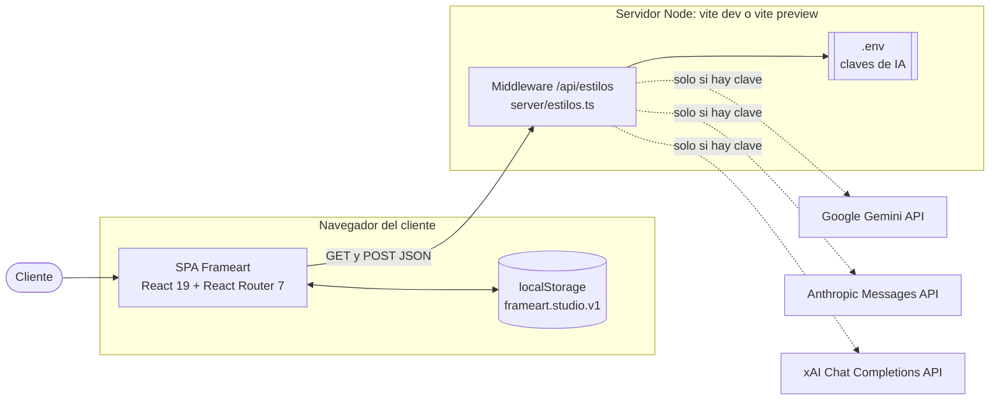
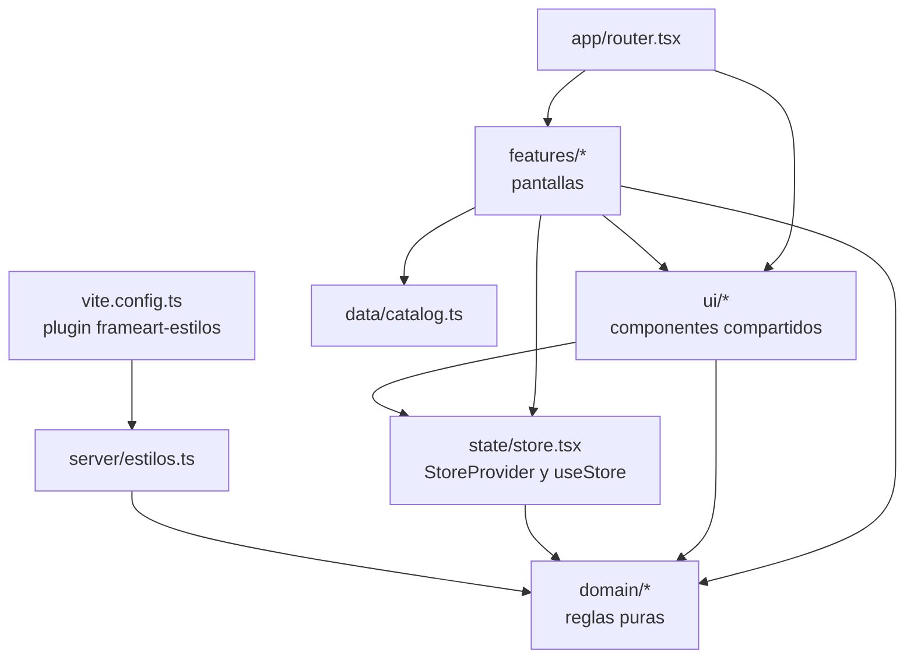
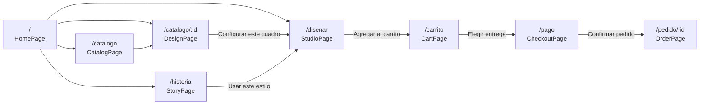
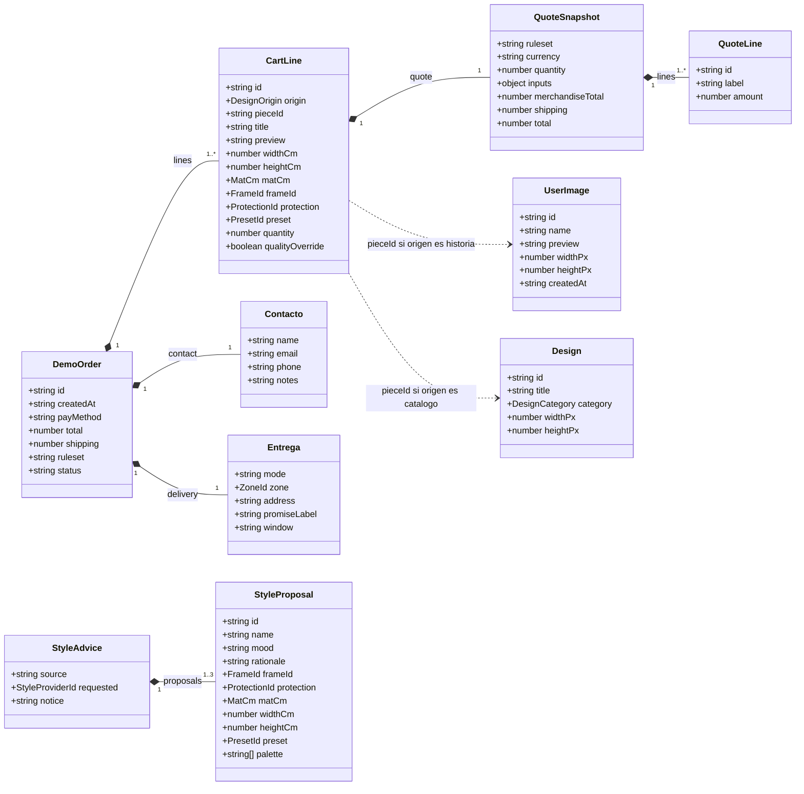

# Arquitectura

Describe el prototipo `frameart` tal como está el 22-11-2026.

## 1. Contexto

Frameart es una aplicación de una sola página (SPA). Todo el negocio corre en el navegador del cliente, salvo una cosa: pedir propuestas de estilo a un modelo de IA, que pasa por un endpoint del servidor de Vite para no exponer las claves.



Fronteras de confianza:

- Las claves de IA viven en `.env` y solo las lee [vite.config.ts](../vite.config.ts) con `loadEnv(mode, root, "")`. No llevan prefijo `VITE_`, así que Vite nunca las incrusta en el bundle del cliente.
- La foto del cliente sale del navegador solo cuando pide una propuesta **y** el servidor tiene clave del proveedor elegido. Sin clave, el servidor responde con el estudio local y no llama a la red.
- Precio, carrito y pedido se calculan y guardan en el navegador. Ningún servidor los valida (ver [§9](#9-brechas-y-riesgos-conocidos)).

## 2. Contenedores y despliegue

| Contenedor | Dónde corre | Responsabilidad |
|---|---|---|
| SPA | Navegador | Rutas, pantallas, configurador, cotización, carrito y checkout simulado. |
| `localStorage` | Navegador | Persistir carrito, fotos subidas (como data URL JPEG) y el último pedido. |
| Middleware `/api/estilos` | Proceso de Vite (`configureServer` y `configurePreviewServer`) | Informar qué proveedores tienen clave y devolver propuestas de estilo. |
| APIs de IA | Terceros | Leer la foto y proponer marco, margen y medida. |

`npm run build` genera archivos estáticos en `dist/`. El middleware no forma parte de ese resultado: solo existe mientras corre `vite` o `vite preview`. Un hosting estático de `dist/` dejaría a "Mi historia" sin `/api/estilos`.

## 3. Capas y dependencias



La regla que sostiene el diseño: **`domain/` no depende de nada**. Es TypeScript puro, sin React ni APIs del navegador (salvo `Intl`), y lo comparten el cliente y el servidor. Por eso el servidor sanea la respuesta de un modelo con las mismas reglas de medida que usa el configurador.

| Carpeta | Contenido | Depende de |
|---|---|---|
| [src/domain/](../src/domain/) | `types.ts` (modelo), `pricing.ts` (tarifa y zonas), `sizing.ts` (medidas, vidrio, resolución), `promise.ts` (fecha de entrega), `styles.ts` (propuestas locales y saneamiento), `money.ts` (pesos chilenos). | nada |
| [src/data/](../src/data/) | Catálogo de 8 láminas con su proporción en píxeles. | nada |
| [src/state/](../src/state/) | Contexto React con el estado persistido y sus acciones. | `domain` |
| [src/ui/](../src/ui/) | `Shell` (layout y navegación), `FramePreview` (marco a escala), `QuoteTicket` (desglose), `NotFoundPage`. | `state`, `domain` |
| [src/features/](../src/features/) | Una carpeta por pantalla, más `art/PrintArt` (SVG de las láminas) y `story/` (lectura de fotos y cliente HTTP de estilos). | todo lo anterior |
| [src/app/](../src/app/) | Router. | `features`, `ui` |
| [server/](../server/) | Adaptador de proveedores de IA. | `domain` |

## 4. Rutas



| Ruta | Componente | Qué hace | Usa |
|---|---|---|---|
| `/` | `HomePage` | Portada, precio de los tres presets para un 30×40 en pino y cuatro láminas destacadas. | `quote` |
| `/catalogo` | `CatalogPage` | Filtro por categoría y búsqueda por título, lugar o etiqueta. Cada tarjeta muestra la medida sugerida y su precio. | `recommendSize`, `quote` |
| `/catalogo/:id` | `DesignPage` | Detalle de una lámina enmarcada y enlace al estudio con la configuración sugerida. | `getDesign`, `quote` |
| `/disenar` | `StudioPage` | Configurador en 4 pasos. Toda la configuración vive en la URL. | URL, `uploads`, `addLine` |
| `/historia` | `StoryPage` | Subida de fotos y propuestas de estilo (IA o estudio local). | `uploads`, `/api/estilos` |
| `/carrito` | `CartPage` | Líneas con precio congelado, cambio de cantidad y eliminación. | `cart` |
| `/pago` | `CheckoutPage` | Entrega (retiro o despacho por zona), contacto y medio de pago simulado. | `cart`, `placeOrder` |
| `/pedido/:id` | `OrderPage` | Confirmación del último pedido de muestra. | `lastOrder` |
| `*` | `NotFoundPage` | Página 404. | — |

Todas cuelgan de [Shell](../src/ui/Shell.tsx), que dibuja cabecera, pie y contador del carrito, y muestra el enlace "Pedido" cuando existe `lastOrder`.

## 5. Estado

Hay tres lugares donde vive el estado, cada uno con un propósito distinto.

### 5.1 Estado global persistido

[state/store.tsx](../src/state/store.tsx) expone `StoreProvider` y `useStore()`. Mantiene un único objeto y lo escribe completo en `localStorage` cada vez que cambia.

```ts
type Persisted = {
  cart: CartLine[];            // líneas con cotización congelada
  uploads: UserImage[];        // fotos reducidas, como data URL JPEG
  lastOrder: DemoOrder | null; // solo el último pedido
};
```

| Acción | Efecto | Reglas |
|---|---|---|
| `addLine(line)` | Agrega una línea o suma cantidad a una igual. | Dos líneas son iguales si coinciden origen, pieza, medida, passe-partout, marco, protección y tarifa. La cantidad se topa en 6 y la línea se recotiza. |
| `updateQuantity(id, n)` | Cambia la cantidad y recotiza. | Si la recotización falla, la línea queda como estaba. |
| `removeLine(id)` | Quita la línea. | — |
| `addUpload(image)` | Agrega la foto al inicio de la lista. | Máximo 12. Devuelve el mensaje de error en vez de lanzar una excepción. |
| `removeUpload(id)` | Quita la foto. | No toca las líneas del carrito: cada línea guarda su propia `preview`. |
| `placeOrder(order)` | Guarda el pedido como `lastOrder` y vacía el carrito. | Solo se conserva el último pedido. |

Al cargar, `load()` descarta lo que no tenga forma válida (`isCartLine`, `isUpload`) y vuelve al estado vacío si el JSON está corrupto. Si `localStorage` se llena (fotos grandes), el error de escritura se ignora: la sesión sigue funcionando, pero ese cambio no sobrevive a una recarga.

### 5.2 Estado en la URL (estudio)

[StudioPage](../src/features/studio/StudioPage.tsx) no guarda la configuración en React: la lee y escribe en los parámetros de la URL con `setSearchParams(next, { replace: true })`. Un enlace reproduce un cuadro exacto, y "Configurar este cuadro" o "Usar este estilo" son enlaces simples.

| Parámetro | Valores | Por defecto |
|---|---|---|
| `origen` | `catalogo`, `historia` | `catalogo` |
| `pieza` | id de lámina o de foto | `valle-maule` si el origen es catálogo |
| `an`, `al` | ancho y alto de la imagen en cm, enteros | 30 y 40 |
| `marco` | `pino`, `negro`, `blanco` | `pino` |
| `paspartu` | `0`, `3`, `5` | `0` |
| `proteccion` | `vidrio`, `acrilico` | `vidrio`, corregido a `acrilico` si el formato no admite vidrio |
| `preset` | `bueno`, `mejor`, `premium`, `a-medida` | `bueno` |
| `paso` | `pieza`, `medida`, `marco`, `resumen` | `medida` |

Solo la cantidad y la casilla "Imprimir igual" son estado local de React.

### 5.3 Estado local de pantallas

`CheckoutPage` guarda el formulario con `useState`. `StoryPage` guarda la selección, el proveedor elegido, la respuesta de estilos y los indicadores de carga y error. Nada de esto se persiste.

## 6. Modelo de datos

Definido en [domain/types.ts](../src/domain/types.ts).



| Tipo | Valores |
|---|---|
| `FrameId` | `pino`, `negro`, `blanco` |
| `ProtectionId` | `vidrio`, `acrilico` |
| `MatCm` | `0`, `3`, `5` |
| `PresetId` | `bueno`, `mejor`, `premium`, `a-medida` |
| `DesignOrigin` | `catalogo`, `historia` |
| `StyleProviderId` | `gemini`, `claude`, `grok` |
| `ZoneId` | `centro`, `las-rastras`, `la-florida`, `norte`, `maule`, `fuera` |
| `DemoOrder.status` | solo `pago-simulado` |
| `DemoOrder.payMethod` | `mercadopago`, `webpay` (ninguno se integra) |

Invariantes de `QuoteSnapshot`: la suma de `lines[].amount` es igual a `total`; `total` es múltiplo de 100; `ruleset` identifica la tarifa con la que se calculó. En el carrito `shipping` es 0: el despacho se suma en el checkout.

## 7. API interna `/api/estilos`

Montada por el plugin `frameart-estilos` de [vite.config.ts](../vite.config.ts); la lógica está en [server/estilos.ts](../server/estilos.ts). El cliente está en [features/story/styleClient.ts](../src/features/story/styleClient.ts).

### `GET /api/estilos`

Indica qué proveedores tienen clave en el servidor, sin revelarla.

```json
{ "gemini": true, "claude": false, "grok": false }
```

### `POST /api/estilos`

Petición (`StyleRequest`):

```json
{
  "provider": "gemini",
  "title": "Patio de la casa",
  "brief": "Foto personal del cliente para imprimir y enmarcar.",
  "widthPx": 3024,
  "heightPx": 4032,
  "imageDataUrl": "data:image/jpeg;base64,..."
}
```

Respuesta (`StyleAdvice`):

```json
{
  "source": "estudio",
  "requested": "gemini",
  "notice": "Sin clave de Gemini en el servidor. El estudio local arma la propuesta y la foto no sale de este computador.",
  "proposals": [
    {
      "id": "claro", "name": "Claro y simple", "mood": "Diario",
      "rationale": "...", "frameId": "pino", "protection": "vidrio",
      "matCm": 0, "widthCm": 30, "heightCm": 40, "preset": "bueno",
      "palette": ["#C4A574", "#F6F1E8", "#2C2420"]
    }
  ]
}
```

| Caso | Respuesta |
|---|---|
| `provider` desconocido o ausente | Se usa `gemini`. |
| Sin clave del proveedor | 200, `source: "estudio"`, 3 propuestas locales, sin llamada de red. |
| El proveedor responde con al menos una propuesta válida | 200, `source` = proveedor, hasta 3 propuestas saneadas. |
| El proveedor falla, tarda más de 20 s, devuelve JSON ilegible o ninguna propuesta válida | 200, `source: "estudio"`, propuestas locales y un aviso. |
| Cuerpo mayor a 2,5 MB o JSON ilegible | 400 `{ "error": "No pudimos leer la solicitud de estilos." }` |
| Método distinto de GET o POST | 405 `{ "error": "Usa POST" }` |

Saneamiento de la entrada: título y notas sin espacios repetidos y con máximo 180 caracteres; píxeles enteros positivos (por defecto 800×1000); la imagen se acepta solo como data URL `image/jpeg`, `image/png` o `image/webp` de hasta 2,2 MB en base64. Si no cumple, se envía el prompt sin imagen.

| Proveedor | Endpoint | Autenticación | Imagen | Modelo por defecto |
|---|---|---|---|---|
| Gemini | `generativelanguage.googleapis.com/v1beta/models/{modelo}:generateContent` | `x-goog-api-key` | `inline_data` | `GEMINI_MODEL` o `gemini-2.5-flash` |
| Claude | `api.anthropic.com/v1/messages` | `x-api-key` y `anthropic-version: 2023-06-01` | bloque `image` en base64 | `ANTHROPIC_MODEL` o `claude-sonnet-4-5` |
| Grok | `api.x.ai/v1/chat/completions` | `Authorization: Bearer` | `image_url` con data URL | `XAI_MODEL` o `grok-4` |

Las tres llamadas usan temperatura 0,4. El prompt fija las restricciones de fabricación y prohíbe prometer precios, fechas o stock.

## 8. Decisiones de diseño

1. **Una sola autoridad de precio.** Toda pantalla que muestra un precio llama a `quote()` de [domain/pricing.ts](../src/domain/pricing.ts). Ninguna calcula montos por su cuenta, y la IA nunca propone precios.
2. **Cotización congelada.** Cada línea del carrito guarda su `QuoteSnapshot` con la tarifa. El checkout suma esos snapshots sin recalcular.
3. **Solo combinaciones fabricables.** `sizeIssue` y `coerceProtection` actúan en tres lugares: la interfaz (botones deshabilitados), el motor de precio (rechaza) y el saneamiento de propuestas de IA (repara o descarta).
4. **La IA propone, el dominio decide.** El modelo devuelve JSON libre; `normalizeProposal` lo recorta a valores válidos. Si nada sirve, responde el estudio local. El cliente nunca ve un error del proveedor, solo un aviso.
5. **Privacidad por omisión.** Las fotos quedan en el navegador y solo salen a pedido, con clave configurada.
6. **La URL como estado del configurador.** Permite compartir, recargar y enlazar configuraciones exactas.
7. **Promesa estable.** La carga de cada salida se deriva de la fecha (`routeLoad`), así la fecha prometida no cambia al recargar.
8. **`fetch` inyectable.** `advise()` recibe `fetchImpl`, lo que permite probar el adaptador sin red ([server/estilos.test.ts](../server/estilos.test.ts)).
9. **SVG de confianza.** `PrintArt` usa `dangerouslySetInnerHTML` con SVG constante escrito en el código. No debe recibir contenido del usuario ni de la IA.

## 9. Brechas y riesgos conocidos

Revisión de código del 22-11-2026. No se ejecutaron las pruebas porque el proyecto no tiene dependencias instaladas.

| # | Hallazgo | Impacto |
|---|---|---|
| 1 | Faltan `index.html`, `src/main.tsx` y la hoja de estilos. | `npm run dev` no sirve la app y `vite build` falla sin `index.html`. |
| 2 | `/api/estilos` existe solo dentro de `vite dev` o `vite preview`. | Un despliegue estático de `dist/` pierde las propuestas de estilo: la página muestra "No pudimos pedir estilos". |
| 3 | Precio, carrito y pedido se calculan en el navegador. | Aceptable en un prototipo. Para cobrar de verdad, un servidor debe recotizar y rechazar diferencias. |
| 4 | Pago simulado (`status: "pago-simulado"`), id `FA-` más 4 dígitos aleatorios, y solo se guarda el último pedido. | No hay trazabilidad ni unicidad de pedidos. |
| 5 | El cupo de reparto es simulado: `reserved` va de 8 a 16 sobre una capacidad de 20. | La lista de espera (`waitlist`) nunca se activa con la simulación actual. |
| 6 | `updateQuantity` recotiza con la tarifa vigente, no con la grabada en la línea. | Si cambia `RULESET`, cambiar la cantidad actualiza el precio de una línea que se presenta como congelada. |
| 7 | La prueba "cotiza 30×40 pino y vidrio en $29.400" espera una línea de redondeo de $80, pero el cálculo da $100 (8.500 + 9.500 + 6.800 + 4.500 = 29.300; total 29.400). Ver [dominio.md §2](dominio.md#ejemplo-3040-pino-vidrio-sin-passe-partout). | Esa aserción de `npm test` debería fallar. |
| 8 | Las fotos se guardan como data URL en `localStorage` (cerca de 5 MB por origen en la mayoría de los navegadores). | Con varias fotos la escritura falla en silencio y se pierden al recargar. |

## 10. Relación con la arquitectura objetivo

[master-prompt-investigacion-requerimientos-tienda-cuadros.md](../master-prompt-investigacion-requerimientos-tienda-cuadros.md) describe el sistema completo: backend .NET 10 como monolito modular, MongoDB, despliegue en GCP (Cloud Run), inicio de sesión con Google, pago confirmado por webhook firmado, inventario, producción, conductores y panel de administración.

El prototipo cubre la experiencia del cliente y deja el dominio aislado para trasladarlo:

| Prototipo | Destino natural en la arquitectura objetivo |
|---|---|
| `domain/pricing.ts`, `domain/sizing.ts` | Módulo de producto y precios (`PriceRuleSet`, `CompatibilityRule`, `Quote`). Si el backend es .NET, una réplica en C# verificada con los mismos casos de prueba. |
| `domain/promise.ts` | Módulo de entregas (`DeliverySlot`, `DeliveryPlan`) con capacidad real en vez de `routeLoad` simulado. |
| `server/estilos.ts` | Adaptador de IA del backend; ya sigue el patrón Adapter. |
| `state/store.tsx` (carrito y pedido) | `Cart`, `Order` y `Payment` persistidos en el servidor. |
| `data/catalog.ts` y `features/art/PrintArt.tsx` | `DesignAsset` y `Category`, con imágenes en Cloud Storage y CDN. |
| `CheckoutPage` y `OrderPage` | Flujo de pago real: el backend crea la transacción y el webhook confirma el pago, nunca el frontend. |
