# Flujos de secuencia

Cada diagrama sigue un recorrido real del código. Los participantes son módulos de `src/` y `server/`; las reglas de negocio que aparecen se explican en [dominio.md](dominio.md).

1. [Arranque y rehidratación del estado](#1-arranque-y-rehidratación-del-estado)
2. [Del catálogo al estudio](#2-del-catálogo-al-estudio)
3. [Configurar un cuadro en el estudio](#3-configurar-un-cuadro-en-el-estudio)
4. [Agregar al carrito](#4-agregar-al-carrito)
5. [Subir una foto a Mi historia](#5-subir-una-foto-a-mi-historia)
6. [Proponer estilos con IA o con el estudio local](#6-proponer-estilos-con-ia-o-con-el-estudio-local)
7. [Usar un estilo propuesto](#7-usar-un-estilo-propuesto)
8. [Checkout y confirmación del pedido](#8-checkout-y-confirmación-del-pedido)
9. [Ciclos de vida](#9-ciclos-de-vida)

## 1. Arranque y rehidratación del estado

El punto de entrada (`src/main.tsx`) aún no existe; el diagrama muestra el montaje que esperan `Shell` y las páginas.

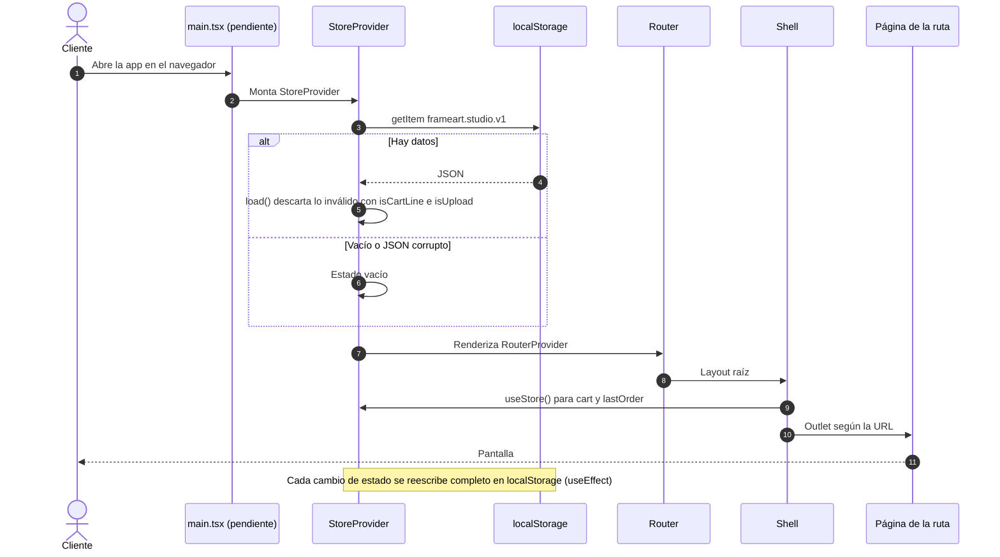

## 2. Del catálogo al estudio

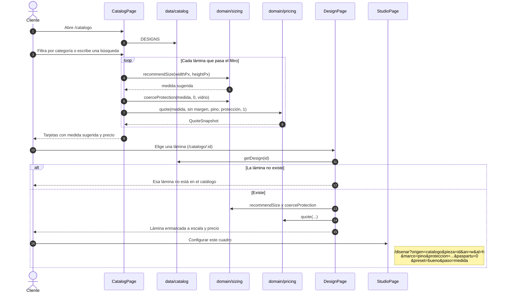

## 3. Configurar un cuadro en el estudio

El estudio no guarda la configuración en React: cada cambio reescribe la URL y la página se vuelve a calcular entera desde ella.

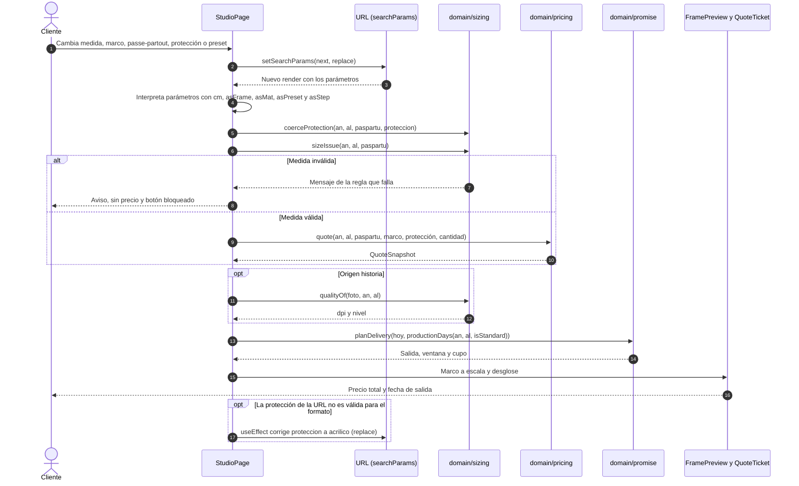

Pasos del inspector. El stepper permite abrir cualquier paso; "Seguir" avanza en orden.

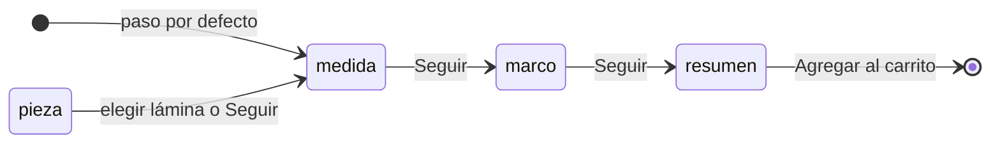

## 4. Agregar al carrito

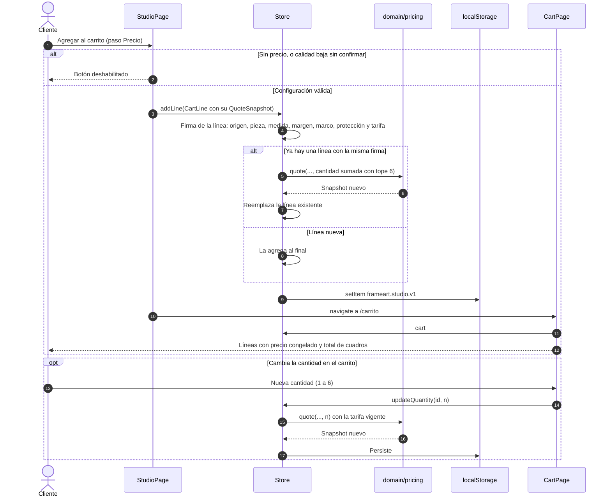

## 5. Subir una foto a Mi historia

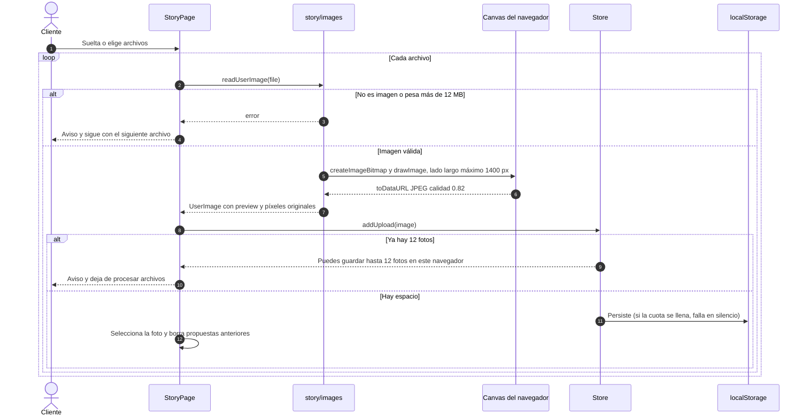

## 6. Proponer estilos con IA o con el estudio local

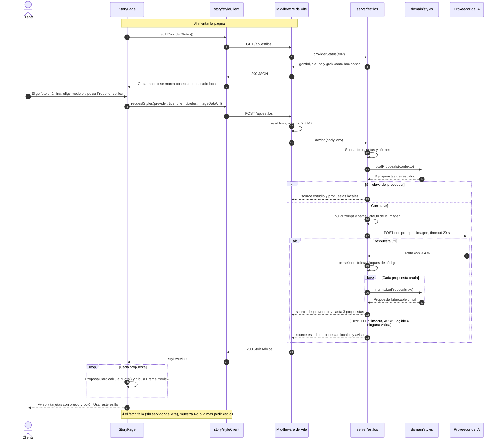

## 7. Usar un estilo propuesto

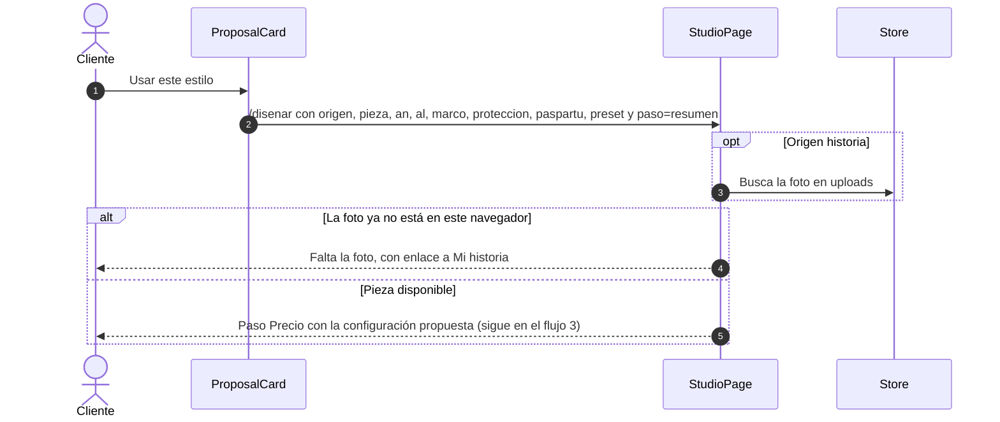

## 8. Checkout y confirmación del pedido

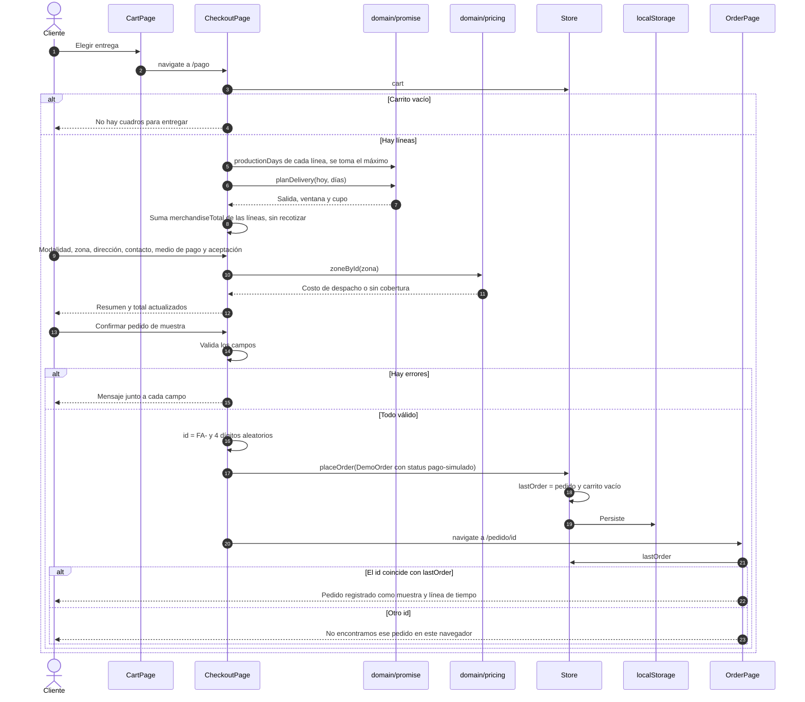

En el piloto real el pago no se confirmaría desde esta pantalla: el backend crearía la transacción y un webhook firmado de Mercado Pago o Webpay confirmaría el pago (requisito §10 del [master prompt](../master-prompt-investigacion-requerimientos-tienda-cuadros.md)).

## 9. Ciclos de vida

Línea del carrito:

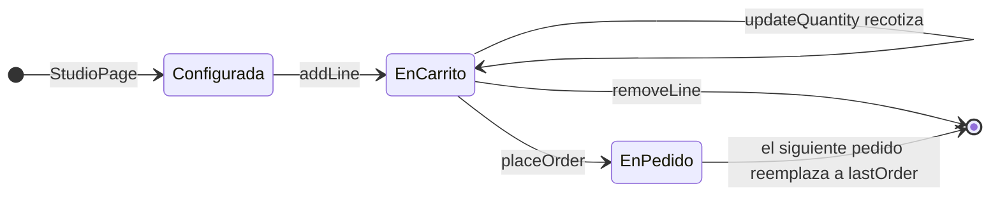

Pedido. `OrderPage` muestra cuatro etapas, pero solo la primera existe en el código; el resto es la línea de tiempo prevista.

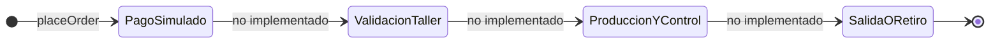
